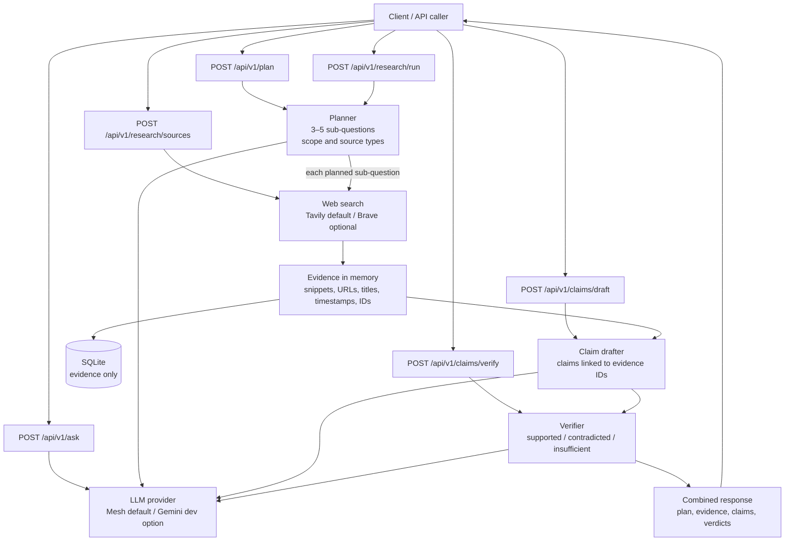

# DeepDive

DeepDive is an API-first research system that aims to verify individual claims
against the source passages cited for them.

## Current milestone

The API exposes separate planning, search, claim-drafting, and verification
endpoints, plus `POST /api/v1/research/run` to execute those stages together.
The run endpoint creates a validated plan, searches each sub-question, stores
the collected evidence in SQLite, drafts evidence-linked claims, verifies each
claim against its attached passages, and returns the combined result.

## Workflow



Every API request gets a correlation ID and logs stage start, completion,
duration, and failures. Slow LLM requests emit a heartbeat every 15 seconds.
The workflow currently searches using snippets; it does not fetch full pages,
retry weak evidence, persist claims/verdicts, or generate a narrative report.

## Setup

From PowerShell in this directory:

```powershell
py -m venv .venv
.\.venv\Scripts\Activate.ps1
python -m pip install -r requirements-dev.txt
python -m uvicorn app.main:app --reload
```

Open <http://127.0.0.1:8000/docs> for the API documentation. The health
endpoint is available at <http://127.0.0.1:8000/health> and returns
`{"status":"ok"}`.

## Request and stage logs

Uvicorn prints request and processing-stage logs to the terminal. Each request
gets a correlation ID, returned in the `X-Request-ID` response header and
included in its log lines. Follow that ID to see request start/completion,
provider calls, planning, search and evidence persistence, claim drafting, and
verification, including elapsed time and safe result counts. Failures include
the failing stage and exception type. Prompts, questions, source passages,
provider responses, and API keys are not included in stage logs.
The app configures its own INFO-level console handler, so these stage logs are
visible even when Uvicorn's logging configuration does not enable application
INFO logs. A slow LLM request emits a `stage=llm.request event=started` line
before waiting for the provider, then a `still_running` heartbeat every 15
seconds, followed by completion or failure with elapsed time.

To try the Planner endpoint, send a JSON request such as
`{"question":"How is urban tree cover changing?"}` to
`POST /api/v1/plan`.

To run the complete current pipeline in one call, send
`{"question":"How does urban tree cover affect local temperatures?","results_per_query":3}`
to `POST /api/v1/research/run`. `results_per_query` is optional and ranges from
1 to 5. The response includes the generated plan, gathered evidence, drafted
claims, and verification results. This endpoint does not yet synthesize a
narrative report.

Search uses Tavily by default. Create an API key in the
[Tavily dashboard](https://app.tavily.com), set `TAVILY_API_KEY` in `.env`, and
restart the app. Tavily currently provides 1,000 free search credits per month;
basic searches cost one credit. Send
`{"query":"urban tree cover and heat","count":5}` to
`POST /api/v1/research/sources`. Returned passages are search-result content
snippets, not full-page evidence; the response labels them `search_snippet`.
Evidence is persisted to `data/deepdive.sqlite3`, which is ignored by Git.

Brave remains available by setting `SEARCH_PROVIDER=brave` and configuring
`BRAVE_SEARCH_API_KEY`. The provider setting defaults to `tavily`.

Pass the returned evidence records to `/api/v1/claims/draft` with the original
question, then pass the resulting claims and the same evidence records to
`/api/v1/claims/verify`. The claim endpoints validate that model-generated
evidence IDs refer only to records included in the request. Verification
results are model assessments, not independent proof of factual truth.
These claim endpoints currently accept evidence and claims in the request body;
claims and verdicts are not yet persisted to SQLite. The combined research-run
endpoint accepts a question and an optional `results_per_query` value (default
3, maximum 5). A complete run makes one search call for each plan sub-question;
if a search stage fails, the run stops before persisting partial evidence or
drafting claims. Search evidence is still snippets rather than full-page
content, and the endpoint does not yet retry weak claims or synthesize a final
narrative report.

## Tests

```powershell
python -m pytest
```

## Configuration and secrets

Copy `.env.example` to `.env` and add your provider's key. Set
`LLM_PROVIDER=mesh` to use Mesh (the hackathon target), or set
`LLM_PROVIDER=gemini` for temporary local testing with the Gemini API directly.
Each provider has its own key and model settings; never reuse or relabel a
provider key. Gemini-direct calls bypass Mesh and are for development testing
only. The Gemini model should be one enabled for your key; the current local
setup was verified with `gemini-3.8-flash`. The selected search provider uses
its own key (`TAVILY_API_KEY` for Tavily or `BRAVE_SEARCH_API_KEY` for Brave),
separate from the LLM key. Restart Uvicorn after
changing `.env` so the app loads the selected provider and settings. Keep real
keys in `.env` only—never put them in `.env.example` or source control. `.env`
is ignored by Git.
