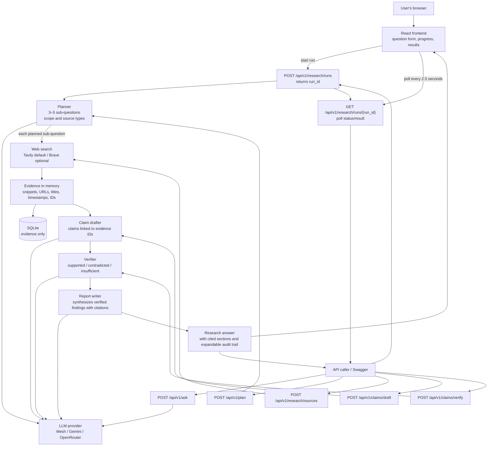

# DeepDive

DeepDive is an API-first research system that aims to verify individual claims
against the source passages cited for them.

## Current milestone

The API exposes separate planning, search, claim-drafting, and verification
endpoints, plus `POST /api/v1/research/runs` to start those stages as a
background job.
The run endpoint creates a validated plan, searches each sub-question, stores
the collected evidence in SQLite, drafts evidence-linked claims, verifies each
claim against its attached passages, and synthesizes the verified findings
into a cited research answer. The UI presents the answer first and keeps the
plan, source snippets, and claim-level checks in an expandable research trail.

## Workflow



Every API request gets a correlation ID and logs stage start, completion,
duration, and failures. Slow LLM requests emit a heartbeat every 15 seconds.
The workflow currently searches using snippets; it does not fetch full pages,
or retry weak evidence. The final narrative uses an additional LLM call after
claim verification; claims and verdicts remain available in the audit trail.

## Setup

From PowerShell in this directory:

```powershell
py -m venv .venv
.\.venv\Scripts\Activate.ps1
python -m pip install -r requirements-dev.txt
python -m uvicorn app.main:app --reload
```

### Run the web UI locally

Run the backend in one PowerShell window using the command above. In a second
window, from the project directory, start the React frontend:

```powershell
Set-Location .\frontend
npm install
npm run dev
```

Open the local URL printed by Vite (usually <http://localhost:5173>). The
frontend submits research questions, polls the job status endpoint every 2.5
seconds automatically, and displays a synthesized, evidence-cited answer.
The underlying plan, source snippets, claims, and verdicts are available in a
collapsed research trail. Vite proxies `/api` requests to the local FastAPI server.
For a deployed frontend, set `VITE_API_BASE_URL` to the API base URL (for
example, `https://api.example.com/api/v1`) at frontend build time and configure
`FRONTEND_ORIGINS` in the backend `.env` to the deployed site's origin.

Keeping `frontend/` in this repository is a normal monorepo setup and does not
require deploying it with the API. Build and deploy the frontend independently
as a static site (for example, with AWS Amplify Hosting or S3 + CloudFront), and
deploy the FastAPI backend as a separate service. Configure the frontend API
base URL and backend CORS origin for the deployed domains.

Open <http://127.0.0.1:8000/docs> for the API documentation. The health
endpoint is available at <http://127.0.0.1:8000/health> and returns
`{"status":"ok"}`.

## Request and stage logs

Uvicorn prints request and processing-stage logs to the terminal. Each request
gets a correlation ID, returned in the `X-Request-ID` response header and
included in its log lines. Follow that ID to see request start/completion,
provider calls, planning, search and evidence persistence, claim drafting,
verification, and report synthesis, including elapsed time and safe result
counts. Failures include the failing stage and exception type. Prompts,
questions, source passages,
provider responses, and API keys are not included in stage logs.
The app configures its own INFO-level console handler, so these stage logs are
visible even when Uvicorn's logging configuration does not enable application
INFO logs. A slow LLM request emits a `stage=llm.request event=started` line
before waiting for the provider, then a `still_running` heartbeat every 15
seconds, followed by completion or failure with elapsed time.

To try the Planner endpoint, send a JSON request such as
`{"question":"How is urban tree cover changing?"}` to
`POST /api/v1/plan`.

To run the complete current pipeline in one call, send
`{"question":"How does urban tree cover affect local temperatures?","results_per_query":3}`
to `POST /api/v1/research/runs`. The endpoint returns `202 Accepted` with a
`run_id` and `status_url`. Poll that URL with `GET` to see the current stage;
when status is `completed`, the response contains a synthesized `report` and
the supporting plan, evidence, claims, and verifications under `result`. A
failed run includes an `error` message.
The frontend keeps the run ID internally for polling and does not display it.
Provider failures are logged server-side while the frontend receives a concise,
actionable message rather than raw upstream error details.
`results_per_query` is optional and ranges from 1 to 5. The synchronous
`POST /api/v1/research/run` endpoint remains available for direct API use.

Search uses Tavily by default. Create an API key in the
[Tavily dashboard](https://app.tavily.com), set `TAVILY_API_KEY` in `.env`, and
restart the app. Tavily currently provides 1,000 free search credits per month;
basic searches cost one credit. Send
`{"query":"urban tree cover and heat","count":5}` to
`POST /api/v1/research/sources`. Returned passages are search-result content
snippets, not full-page evidence; the response labels them `search_snippet`.
Evidence is persisted to `data/deepdive.sqlite3`, which is ignored by Git.

Brave remains available by setting `SEARCH_PROVIDER=brave` and configuring
`BRAVE_SEARCH_API_KEY`. The provider setting defaults to `tavily`.

Pass the returned evidence records to `/api/v1/claims/draft` with the original
question, then pass the resulting claims and the same evidence records to
`/api/v1/claims/verify`. The claim endpoints validate that model-generated
evidence IDs refer only to records included in the request. Verification
results are model assessments, not independent proof of factual truth.
These claim endpoints currently accept evidence and claims in the request body.
Research job state and completed results are persisted in SQLite, along with
the separately persisted evidence. The job runner currently runs in the API
process rather than a durable external queue; interrupted queued/running jobs
are marked failed when the service restarts. A complete run makes one search
call for each plan sub-question; if a search stage fails, it stops before
persisting partial search evidence or drafting claims. Search evidence is still
snippets rather than full-page content, and the endpoint does not yet retry
weak claims. The report writer synthesizes verified claim assessments into a
readable answer and validates its source IDs against verifier-selected
evidence; the model-generated synthesis is still an AI assessment, not proof.

## Tests

```powershell
python -m pytest
```

## Configuration and secrets

Copy `.env.example` to `.env` and add your provider's key. Set
`LLM_PROVIDER=mesh` for Mesh (the hackathon target), `LLM_PROVIDER=gemini` for
direct Gemini API testing, or `LLM_PROVIDER=openrouter` to use a model available
in your OpenRouter account. OpenRouter uses its OpenAI-compatible API endpoint;
set `OPENROUTER_API_KEY` and `OPENROUTER_MODEL` to the key and exact model slug
shown in your OpenRouter account/model catalog. Availability, speed, and
pricing/quota depend on the selected model and upstream provider; enabling a
different API gateway does not itself guarantee that model calls will succeed.
Each integration has its own key and model settings; never reuse or relabel a
provider key. The selected search provider uses its own key
(`TAVILY_API_KEY` for Tavily or `BRAVE_SEARCH_API_KEY` for Brave), separate from
the LLM key. Restart Uvicorn after changing `.env` so the app loads the
selected provider and settings. Keep real keys in `.env` only—never put them in
`.env.example` or source control. `.env` is ignored by Git.
